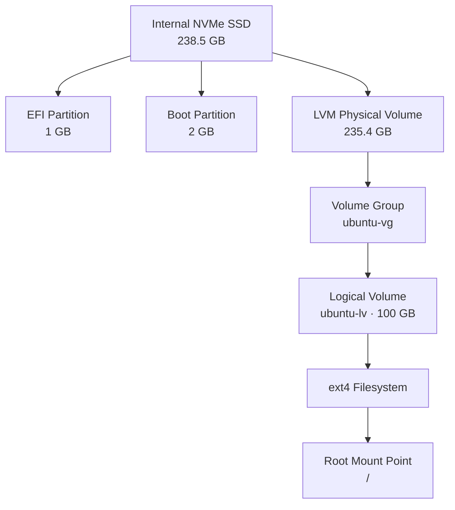

# Storage Architecture

The homelab server uses an internal 256 GB NVMe SSD for Ubuntu Server and an external 1 TB HDD for data storage. LVM provides flexible management of the internal storage, while the external drive remains separate.

## 1. Internal Disk Layout

The internal NVMe SSD is divided into three partitions:

| Partition | Size | Purpose |
|---|---:|---|
| `/dev/nvme0n1p1` | 1 GB | EFI boot files (`/boot/efi`) |
| `/dev/nvme0n1p2` | 2 GB | Linux boot files (`/boot`) |
| `/dev/nvme0n1p3` | 235.4 GB | LVM physical volume |

The partitions serve different purposes:

- **EFI:** Contains files used by UEFI firmware to start Ubuntu.
- **Boot:** Stores the Linux kernel and files required during startup.
- **LVM:** Provides storage for the volume group that manages the root filesystem.

### Storage Hierarchy

